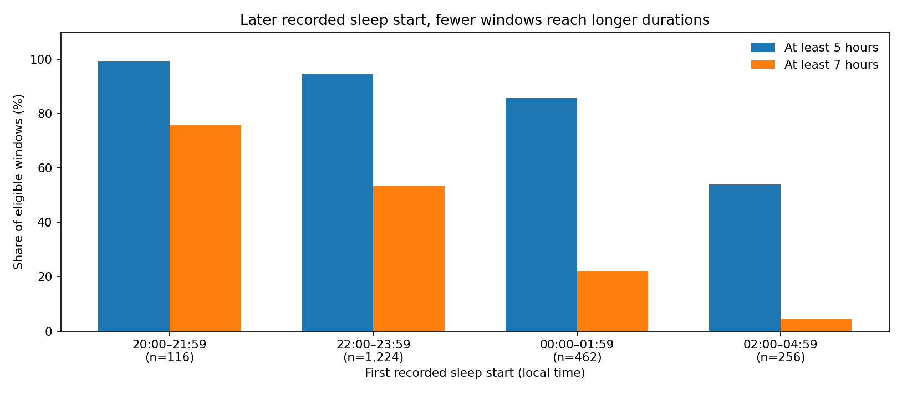
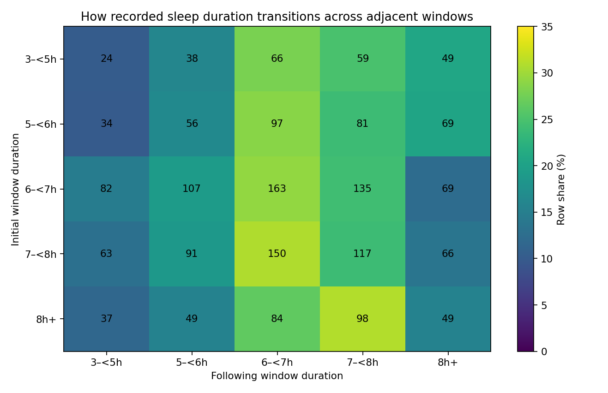

# Sleep Sweet Spot
### From a decade of sleep records to better-informed decisions

**Rogelio Moreno Guinea | Retrospective case study | Historical export: September 2016–October 1, 2026**

**Status:** Stage 1, retrospective. Findings are descriptive and specific to one participant.

> Data rarely speaks for itself. Context turns information into decisions.

## The question that started the investigation

After recognizing my own experience in a discussion of *biphasic sleep*, I asked a simple question: are nights with two substantial episodes truly a recurring pattern, or are those nights simply easier to remember?

What began as a question about interruptions became a broader investigation into the **quality of the measurements**, the relationship between sleep timing and subsequent nights, and the value of questioning intuitive explanations. The goal of Stage 1 is to identify reliable historical patterns, investigate competing interpretations, and understand which findings can inform everyday decisions. Whether those decisions improve daytime functioning is a **different question**, reserved for a later prospective study.

### Scope in one glance

| Source period | What it contributes | Comparable measures? |
| --- | --- | --- |
| 2016 onward | Apple Health sleep-related records, including iPhone Clock and other sources | **Not** the same as Watch-measured sleep |
| 2018 onward | Sleep++ app estimates | Separate algorithm, overlapping other sources |
| 2020–2026 | Watch-labeled sleep intervals | Main timing and consecutive-night analysis |
| Sep 2022–Sep 2026 | Watch-labeled Core / Deep / REM / Awake | Architecture and split-episode analyses |

The full sleep-only source export contains **60,903 interval records**. These are not 60,903 nights, and were **not** pooled into one ten-year comparable sleep-duration series. Using an Apple Watch during this period does not mean every Apple Health record originated on the Watch: earlier Clock / time-in-bed entries can be attributed to an iPhone. **Sleep++ is a third-party app**, not an Apple Watch model.

## Four findings

### 1. A later sleep start is not matched by an equally later finish

From **2,058 eligible Watch-labeled sleep windows** (2020–2026), a one-hour later first recorded sleep start was associated with:

- **29.73 fewer minutes** of recorded sleep, exploratory 95% CI **−32.05 to −27.42** minutes.
- **23.76 minutes later** final recorded sleep time, 95% CI **21.38 to 26.13** minutes.

These are calendar-adjusted associations (year, month, weekday) with uncertainty clustered by month-year, **not causal effects**. Start, end, and duration are also mathematically connected; the coefficients should not be read as independent mechanisms.

| Recorded first-sleep start | Eligible windows | Reached ≥5h | Reached ≥7h |
| --- | ---: | ---: | ---: |
| 20:00–21:59 | 116 | 115 | 88 |
| 22:00–23:59 | 1,224 | 1,159 | 653 |
| 00:00–01:59 | 462 | 396 | 102 |
| 02:00–04:59 | 256 | 138 | 11 |

**Practical implication:** as an enjoyable evening continues, I can consciously ask whether staying longer is worth the possibility of reduced sleep. I might still choose to stay. Evidence improves the *decision*, rather than prescribing the answer. The five-hour threshold is **a descriptive cut point, not a recommended sleep duration**.

### 2. The next night is not a guaranteed full recovery

There are **1,933** pairs of genuinely consecutive qualifying windows and **1,817** complete three-window sequences. Among **219 sequences** whose first window records under five hours, median recorded durations are:

**4h 30m → 6h 51m → 6h 47m**.

This pattern is compatible with return toward typical values. **It cannot measure physiological sleep debt or prove full recovery.** Regression to the mean, circumstances and selection must be considered.

### 3. A memorable split night is not the dominant pattern

The strict, reproducible **staged cohort has 1,381** eligible windows (September 2022–September 2026). **105 (7.6%)** meet an operational split definition: a gap of at least 60 minutes between sleep episodes, with at least 60 minutes of recorded sleep on each side. Under 90- and 120-minute gap thresholds the counts are **74** and **48** respectively.

This does not diagnose or rule out physiological biphasic sleep. A gap can include **unmeasured** time, which is not the same as confirmed Awake. These are *noon-to-noon measurement containers* and may occasionally combine distinct physiological episodes.

An earlier research draft reported **1,377** eligible windows after excluding four context-specific windows. For transparent public reproducibility, this release uses **1,381 with no private date-specific exclusions**; the split count stays at 105. The alternate sample is documented but is **not** the public main estimate.

### 4. Data provenance can change the story

Record categories, app algorithms and device/software eras evolved over ten years. Mixing iPhone *InBed*, Sleep++ *AsleepUnspecified* and Apple Watch stage-level estimates as if they were identical measures would create misleading long-term trends. This study therefore separates **source**, **measurement type** and **date range**; it does not claim that ten-year differences represent changes in physiology.

## Reproducibility and privacy

- [Methods and filtering choices](METHODS.md)
- [Detailed numerical results and interpretive limits](RESULTS.md)
- [Reproducing findings and running the code](REPRODUCIBILITY.md)
- [What was considered, what was deferred](RESEARCH_LEDGER.md)
- [Data dictionary and disclosure policy](DATA_PRIVACY.md)
- [Actual group-level, privacy-reviewed candidate tables](data/public_onset_counts.csv)
- [Consecutive-night transition matrix](data/public_next_night_matrix.csv)
- [Stage-level summary](data/public_stage_summary.csv)

The public CSVs contain **real aggregates, not synthetic observations**. They allow re-creating the charts and percentages, but **not** independently verifying every regression or interval-reconstruction decision. The executable research pipeline can operate on one's own permitted **sleep-only** Apple Health JSON export. The original participant-level health records, exact nightly dates and free-text context are **not included**.

### Quick start

Environment: Python **3.10+**. Install the dependencies in an isolated virtual environment:

    python -m pip install -r requirements.txt
    python -m pip install -r requirements-figures.txt

    python -m pytest -q
    python scripts/build_figures.py

The synthetic demos (`demo_synthetic.py`, `demo_episodes.py`, `demo_statistics.py`) contain no personal records. For full analysis against your **own** authorized sleep-only JSON, see [REPRODUCIBILITY.md](REPRODUCIBILITY.md). Keep output files out of version control.

## Conclusion and next question

This case has already shown a practical change: a late-night choice can be made with clearer evidence about the *potential* loss of recorded sleep. It has **not yet shown that such a choice improves the following day's energy, clarity, wellbeing, or long-term health**. Stage 2, begun separately after October 15, 2026, will examine the two-way relationship **day → sleep → next day**. Those records are **not part of this retrospective study**.

**Skills demonstrated:** Python, longitudinal cohort construction, interval reconciliation, timezone-sensitive processing, measurement audit, sensitivity testing, descriptive regression, data visualization, and translating evidence into decisions.

*Single-participant observational research. Findings are exploratory and non-clinical. Last historical window ends October 1, 2026.*

## License

Source code is available under the [MIT License](LICENSE). The license does not grant rights to the original private health records, which are not included. Aggregated tables are shared for transparent inspection with attribution appreciated.
